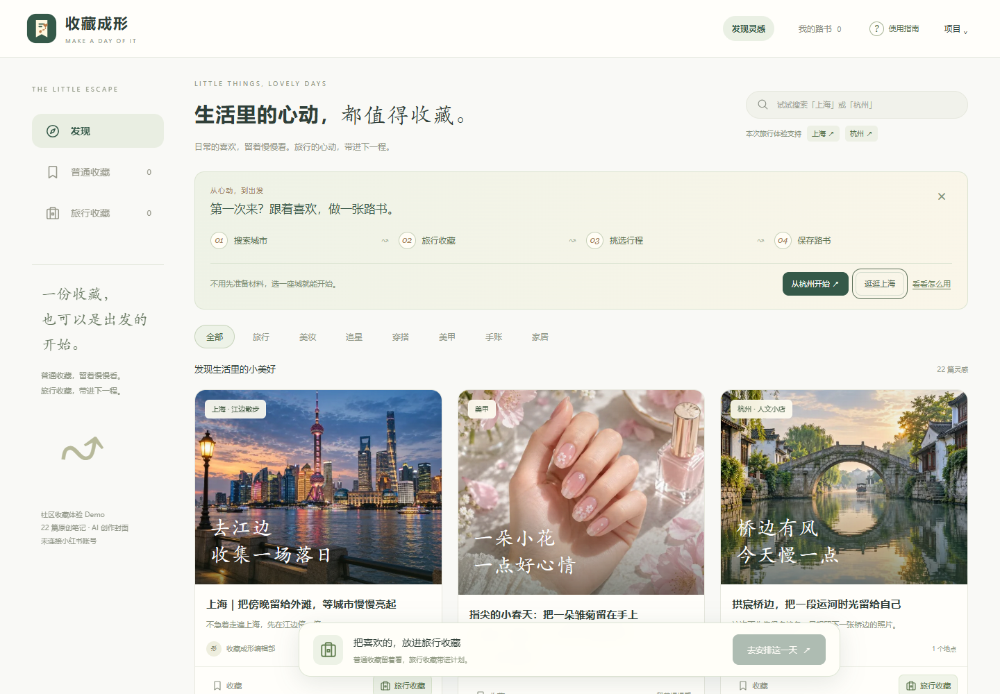

# 收藏成形

**把收藏里的旅行灵感，画成一张属于自己的手绘路书。**

收藏成形是我独立设计和开发的旅行规划工具。收藏一篇攻略，有时只是喜欢里面的一家茶馆、一段湖边小路。你可以从不同笔记里挑出真正想去的地点，排成一天的行程，再把手绘路书发给同行的人。

**[在线体验（无需登录）](https://shoucang-chengxing.netlify.app/)** · [查看杭州示例项目 JSON](deliverables/杭州示例项目.json)



## 做一份自己的路书

1. **收藏想去的地点。** 在发现页选择杭州或上海，把喜欢的旅行笔记加入「旅行收藏」。笔记中的地点会进入候选清单，同一地点自动合并，保留来源供回看。普通收藏留在收藏夹里，你也可以手动添加地点和笔记链接。
2. **安排这一天。** 点击「去安排这一天」，自己挑选最多 6 站，或标记必去地点、选择兴趣和游玩节奏，再点「按偏好整理一天」。整理结果会说明哪些地点是必去、哪些因为符合兴趣被选中。
3. **把计划画下来。** 调整地点顺序、停留时长，或给某一站写句备注，右侧路书会同步更新。选好水彩手账、彩铅地图或复古海报风格，点击「保存手绘路书」即可导出 **1080 × 1440 PNG**。


## 内容、选点与草稿

- **内容来源：** 发现页提供 22 篇原创示例笔记。部分杭州地点参考了真实旅行笔记，在页面中保留来源署名与参考截图。笔记与地点的关联经人工整理，不会自动读取第三方账号或解析外部链接。
- **选点规则：** 优先保留必去地点，再按兴趣匹配；条件相同时沿用收藏顺序。「慢慢来」默认选 3 站，「多看看」默认选 5 站。最终顺序由你决定，应用不计算交通时间或最优路线。
- **草稿保存：** 杭州和上海各自保留行程。草稿保存在当前浏览器，要换设备、浏览器或站点地址，可以在「项目」菜单中导出 JSON，再到新环境导入。

## 技术与本地运行

网站使用 HTML、原生 JavaScript 和 Tailwind CSS，路书预览与图片导出共用一张 Canvas 画布。AI 用于辅助开发和制作插画；生成路书时，浏览器根据地点和风格选择项目内的插画并排版，无需在线模型或 API 密钥。

在项目根目录使用 Node.js 20 或更高版本执行：

```sh
npm ci
npm run build
npm test
```

- **本地体验：** 构建后用浏览器打开 `deliverables/收藏成形-双击预览.html`。这个文件内嵌了脚本、样式和图片，无需启动服务。
- **静态部署：** 将构建生成的 `dist/` 目录发布到静态托管服务，入口为 `dist/index.html`。保留目录内的相对路径即可，无需后端。
- **修改与验证：** 交互和绘图代码在 `public/js/`，插画在 `public/assets/`，样式源文件在 `src/styles.css`。`npm test` 检查行程规则与插画匹配；装有 Microsoft Edge 时，还可运行 `npm run test:community` 验证从收藏到导出的流程。
